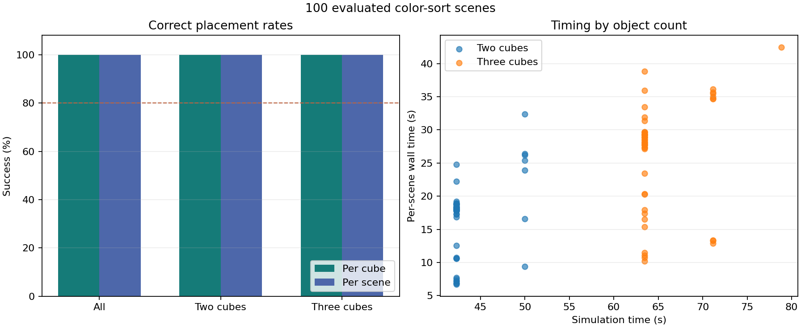

# Panda Color Sort

在 MuJoCo 中用 Franka Emika Panda 自主分拣随机摆放的 2–3 个红蓝方块。机械臂读取仿真场景中的颜色、位置和偏航，按当前可用槽位规划抓取，使用双指夹爪逐个搬运。方块的抓取、移动和释放由 MuJoCo 动力学与接触产生。

## 实验结果

在种子 `20261120–20261219` 的 100 个 headless 场景中，**100/100 轮完整成功，250/250 块正确落槽**。2 块和 3 块模式各 50 轮，最大落槽中心误差为 **0.744 mm**。这批实验使用桌面上经过可达性、间距与碰撞检查的随机初始布局。


### 🎬 机械臂自主颜色分拣演示

基于 MuJoCo 的 Franka Panda 机械臂，实现多目标方块的自主抓取、搬运和颜色分拣。

(https://github.com/user-attachments/assets/efb5af5d-e2cb-42ed-b24d-ad079b7fccaa)

·[完整实验说明](docs/robust-sort.md) · [100 轮场景 CSV](results/robust_sort/combined_100/scenes.csv) · [方块 CSV](results/robust_sort/combined_100/objects.csv) · [失败记录](results/robust_sort/combined_100/failures.csv)

## 快速运行

验证环境为 Windows、Python 3.12 和 MuJoCo 3.16.0。进入仓库根目录，在 PowerShell 创建环境并安装依赖。

```powershell
py -3.12 -m venv .venv
& '.\.venv\Scripts\python.exe' -m pip install -r requirements.txt
& '.\.venv\Scripts\python.exe' -m pytest -q
```

复现三块代表场景或运行无窗口批测。使用新的 `--output-dir` 可保留同一 seed 的多次运行结果。

```powershell
& '.\.venv\Scripts\python.exe' .\src\panda_sort_scenarios.py --count 3 --seed 7301
& '.\.venv\Scripts\python.exe' .\src\panda_sort_evaluate.py --smoke-count 5 --scenes 100 --seed 20261120 --jobs 4 --output-dir .\outputs\sort_reproduction
```

单轮命令加 `--video` 可在有可用 OpenGL 环境时录制。生成的实验数据写入 `outputs/`，仓库随附的验收数据在 `results/`。使用 `--count 2` 可切换到两块。

## 代码入口

| 入口 | 用途 |
| --- | --- |
| `src/panda_cartesian.py` | 七关节伺服、六维末端轨迹与 Jacobian IK |
| `src/panda_pick_place.py` | 固定、随机位置和随机偏航的单块抓放 |
| `src/panda_color_sort.py` | 2–3 块连续分拣 |
| `src/panda_sort_scenarios.py` | 生成随机布局、单轮回放与可选视频 |
| `src/panda_sort_evaluate.py` | 并行 headless 批测、CSV、报告与图表 |
| `src/panda_sort_merge.py` | 校验并合并结果，保留失败记录和来源校验值 |

机器人模型来自 Google DeepMind 的 MuJoCo Menagerie。上游 Panda 模型的 [Apache-2.0 许可证](models/franka_emika_panda/LICENSE) 和 [模型来源](docs/model-source.md) 随仓库提供。
